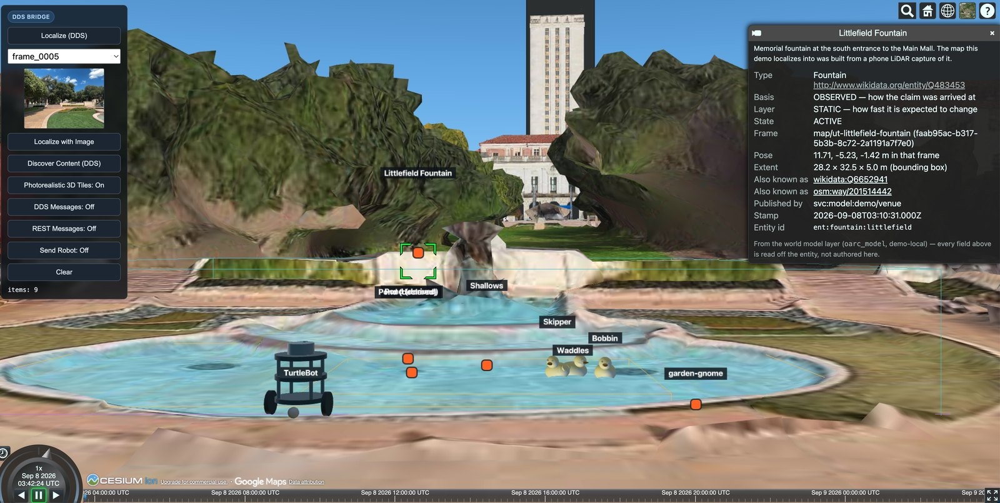
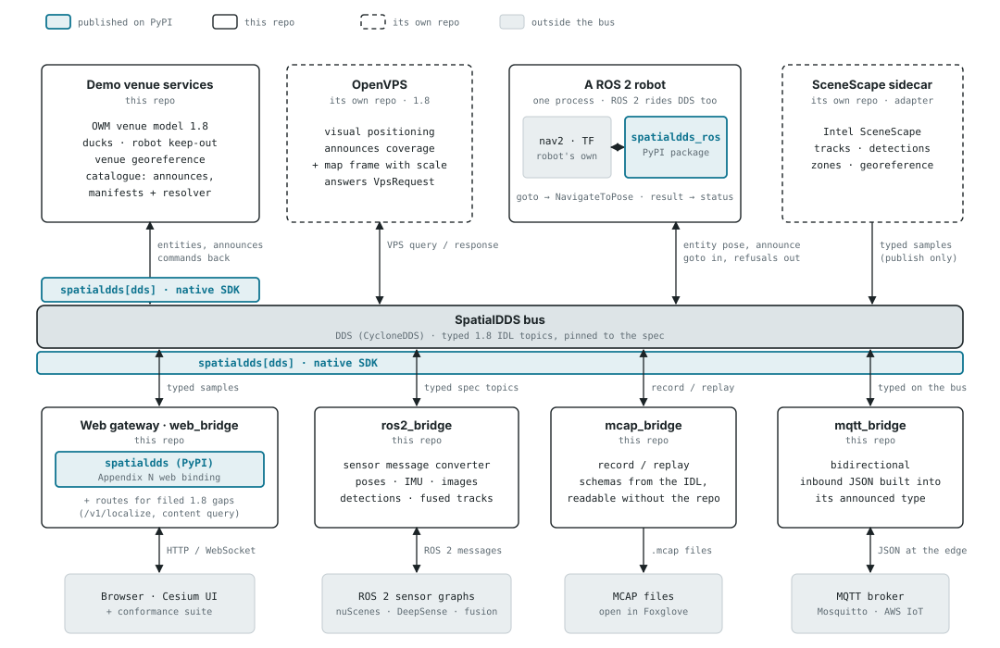

# SpatialDDS Demo



Reference demos for **SpatialDDS 1.8** on CycloneDDS: a browser that finds
its positioning service on the bus, and a venue running as a live model a robot
plans against. The first runs in two commands,
the second in three. The spec types, topic registry and QoS table come from
the published SDK, `spatialdds[dds]`, generated at a pinned spec tag —
[conformance](#conformance) says which, and how that is checked.

## How the pieces fit

<picture>
  <source media="(prefers-color-scheme: dark)" srcset="docs/images/ecosystem-dark.svg">
  
</picture>

Libraries make things native: the venue services and every bridge here open
the bus through the native SDK, [`spatialdds[dds]`](https://pypi.org/project/spatialdds/),
and a robot runs `spatialdds_ros` on the bus it already rides. Bridges
convert, for the worlds that will never be participants.

## The two ISMAR demos

Both need Docker. The web UI also needs Node.

### 1 · SpatialDDS + OpenVPS

A browser localizes against a visual positioning service it discovered on the
bus — no configured endpoint, no per-service client code.

```bash
./run_bridge_server_docker.sh          # VPS + catalogue + bridge on :8088
cd web && npm install && npm run dev   # → http://localhost:5173/
```

With the REST and DDS panels on, **Localize with Image** turns two HTTP calls
into five bus messages and moves the camera to the pose the VPS returns. A
fresh clone sends a labelled **synthetic** frame down that same real path;
real photographs need a [query-frame bundle](ar_demo/README.md#localize-with-image).
**[Full recipe →](docs/ismar-openvps.md)**

### 2 · Open World Model

The screenshot above: the venue as a live model, every entity with identity,
pose, basis and lifecycle, and a ROS 2 robot planning around its declared water.

```bash
SPATIALDDS_MODEL_LAYER=1 SPATIALDDS_POND_WATCH=1 ./run_bridge_server_docker.sh
scripts/run_robot_tier.sh              # second terminal: nav2 plans the routes
cd web && VITE_SPATIALDDS_BINDING_URL=http://localhost:5173 \
          VITE_SPATIALDDS_BINDING_TOKEN=bridge-session npm run dev
```

The two variables let **Send Robot** carry its credential through the dev
server's proxy; plain `npm run dev` still shows the venue live.
**[Full recipe →](docs/ismar-owm.md)**

## Demos

| Demo | Path | What it shows |
|---|---|---|
| **SpatialDDS + OpenVPS** | [`ar_demo/`](ar_demo/README.md) | Bootstrap → discovery → coverage query → localization → catalog → anchor, on a Cesium globe. Runs against real [OpenVPS](https://github.com/OpenArCloud/openvps). |
| **Open World Model** | [`docs/world-model.md`](docs/world-model.md) | Entities, basis and lifecycle on latched topics; a ROS 2 robot planning against declared keep-outs. `spatial.owm/0.1`, SpatialDDS 1.8. |
| Multi-operator fusion | [`multi_operator_fusion/`](multi_operator_fusion/README.md) | Three AV fleet operators and a 6G base station share `Detection3D`; a platform fuser publishes unified `FusedTrack`s. |
| nuScenes → Rerun | [`nuscenes/`](nuscenes/README.md) | nuScenes v1.0-mini as typed samples: ego pose, 6 cameras, LiDAR, 5 radars, 3D annotations. |
| DeepSense 6G → Rerun | [`deepsense/`](deepsense/README.md) | DeepSense Scenario 9 V2I: 60 GHz beam, FMCW radar, camera, GPS, 2D lidar. |
| Benchmarks | [`benchmarks/`](benchmarks/README.md) | Latency, discovery, multi-operator and coverage-query scripts, with plotting. |

## Bridges

Under [`bridges/`](bridges/), and they work with every demo above without
per-demo wiring.

| Bridge | Path | What it does |
|---|---|---|
| Web (HTTP/WebSocket) | [`bridges/web_bridge/`](bridges/web_bridge/README.md) | The browser's way onto the bus, embedding the web binding. |
| MCAP record / replay | [`bridges/mcap_bridge/`](bridges/mcap_bridge/README.md) | Recordings whose schemas come from the IDL. |
| ROS 2 | [`bridges/ros2_bridge/`](bridges/ros2_bridge/README.md) | ROS 2 sensor messages in, decoded spec samples out. |
| MQTT | [`bridges/mqtt_bridge/`](bridges/mqtt_bridge/README.md) | JSON at the broker, typed samples on the bus. |

There are **two** HTTP servers — a gateway and a conformance harness — and they
are not interchangeable: [which one do I want?](docs/servers-and-uis.md)

## Adapters

| Adapter | Repo | What it does |
|---|---|---|
| Intel SceneScape sidecar | [spatialdds-scenescape](https://github.com/OpenArCloud/spatialdds-scenescape) | Publishes a stock SceneScape deployment's scene analytics as typed SpatialDDS samples: tracks, detections, polygon zones, crossing lines, events, and a georeference. Lives in its own repo with its own pins: it vendors SpatialDDS 1.8 at spec commit `424a8b3` beside a pinned SceneScape release, while this repo is at `9c3e1f2`, 21 spec commits later (the 1.8 revision that added `TopicMeta.durability`). Each moves its pin on its own evidence. |

## Conformance

**The demos publish spec IDL types on spec-named topics with spec QoS
profiles.** JSON exists only at the edges — WebSocket clients, MQTT payloads,
MCAP records.

The spec types are the SDK's: [`spatialdds[dds]`](https://pypi.org/project/spatialdds/)
(pinned in [`requirements.txt`](requirements.txt)) generates them, its topic
registry and its QoS table from SpatialDDS-spec's `v1.8` tag, and ships that
IDL. This repository carries its manifest examples in
[`manifests/v1.8`](manifests/v1.8) and its own IDL for the types the spec has
no struct for, generated against the SDK's IDL and checked byte for byte
against it.

> **The pin is a spec tag, not the spec repo's `main`.** Main carries draft
> IDL. Until the SDK adoption this repository vendored `idl/v1.8` from spec
> commit `9c3e1f2` and generated its own spec tree; both are retired, and the
> pin moves with the SDK's.

| package | era | generated from | used by |
| --- | --- | --- | --- |
| `spatialdds.dds.types` (the SDK's) | **1.8**, including provisional `spatial.owm/0.1` | the IDL the SDK ships, from the `v1.8` tag | every demo: the AR demo and its mock VPS, discovery, the Open World Model, the MCAP / MQTT / ROS 2 bridges, fusion, and both web surfaces |
| `spatialdds_demo_idl18` | **1.8** | [`idl/demo18`](idl/demo18) | the demo-owned types the spec has no struct for — bootstrap and fusion-coverage diagnostics — bound to the SDK's types for every spec type |
| `spatialdds_idl18` (`spatialdds_ros`'s own) | **1.8** | spec commit `9c3e1f2` | the robot lane, through the library; held to the SDK's types on the wire by [`tests/test_idl_trees_agree.py`](tests/test_idl_trees_agree.py) |
| `tests/cross_era/spatialdds_idl` | 1.7, **frozen** | the `v1.7` tag's IDL (retired from this repo) | nothing but the cross-era exhibit: 19 of the 1.7 tree's 29 modules<!-- exhibit-subset: modules=19 packages=23 -->, the closure of what its probe needs, checksummed. See [`tests/cross_era/README.md`](tests/cross_era/README.md) |

The claim is verifiable rather than asserted.
[`tests/cross_era/interop_probe.py`](tests/cross_era/interop_probe.py) is a
participant built from 1.7 generated types, the spec's topic names and the
§3.3.3 profile table, with **no demo code** — its path holds nothing else. It
discovers and reads the 1.8 demo, and is read by it, in both directions.

That works because the 1.7 → 1.8 move is appendable evolution as the spec
describes it, and it was measured rather than assumed: of 146 definitions the
two trees share, 138 are byte-identical and the other 8 only *append* members.
The probe is kept frozen as the one deliberate exhibit of the earlier era.
Everywhere else the repository is one era, and
[`tests/test_one_era.py`](tests/test_one_era.py) fails if that stops being
true.

The spec lives at [spatialdds.org](https://spatialdds.org); its source is
[OpenArCloud/SpatialDDS-spec](https://github.com/OpenArCloud/SpatialDDS-spec).

## Everything else

- **Tests** — `scripts/run_tests.sh` (~20 s) or `scripts/run_tests.sh standard`
  (~3 min, adds the container suites).
- **AWS** — [`deploy/aws/`](deploy/aws/README.md).
- **Contributing, and the lessons this repo has paid for** —
  [`CONTRIBUTING.md`](CONTRIBUTING.md).
- **The spec text this demo is pinned to** — SpatialDDS-spec at
  [`9c3e1f2`](https://github.com/OpenArCloud/SpatialDDS-spec/tree/9c3e1f2).
